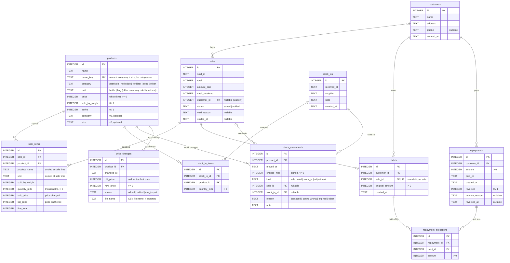

# Store POS: Entity Relationship Diagram

The database is one local SQLite file (`%LOCALAPPDATA%\StorePOS\store.db`), schema version 4.
The tables are created and upgraded in [`StorePOS/Data/Db.cs`](../StorePOS/Data/Db.cs).

## Rules the diagram does not show

- **Money** is stored in whole kyat (`INTEGER`). **Quantities** are stored in thousandths (`*_milli`), so 2.5 kg is `2500`.
- **Dates** are text: `yyyy-MM-dd HH:mm:ss` for times and `yyyy-MM-dd` for `repayments.paid_on`.
- **Stock is never stored.** A product's stock is `SUM(stock_movements.change_milli)`. Rows in `stock_movements` are never edited or deleted.
  - A sale writes one `sale` row per item (negative change). Voiding the sale writes matching `void` rows (positive change).
  - A delivery writes one `stock_ins` row, its `stock_in_items`, and one `stock_in` movement per item.
  - Adjust count writes one `adjustment` movement with a `reason`.
- **A customer's balance** is the sum of `debts.original_amount` for saved (not voided) sales, minus the `repayment_allocations` of repayments that are not reversed.
- **`repayment_allocations`** are rebuilt whenever a repayment is added or reversed, or a credit sale is voided: active repayments pay off open debts, oldest sale first.
- **Nothing is deleted.** Sales are voided with a reason, and repayments are reversed with a reason.
- **`sale_items` copies** the product name, unit and prices, so later edits to a product do not change past sales.
- **`price_changes`** gets a row in the same transaction as every product insert or price change. Products from before schema version 4 have no rows until their price next changes.

## Schema versions

| Version | Adds |
|---|---|
| 1 | `products`, `customers`, `sales`, `sale_items`, `debts`, `repayments`, `repayment_allocations` |
| 2 | `products.company`, `products.size` |
| 3 | `stock_ins`, `stock_in_items`, `stock_movements` |
| 4 | `price_changes` |

`Db.EnsureCreated()` reads `PRAGMA user_version` and applies each missing step in one transaction, so an older database upgrades itself when the app opens it.
