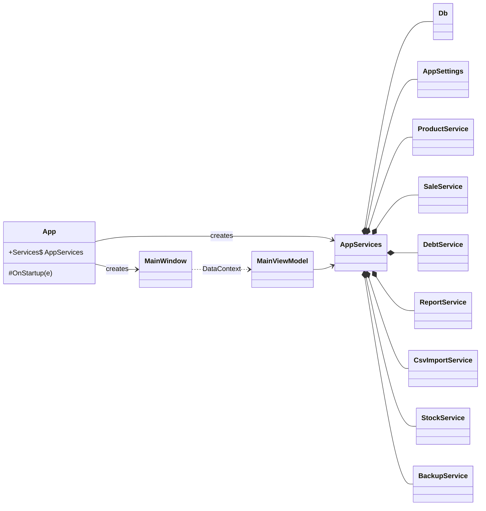
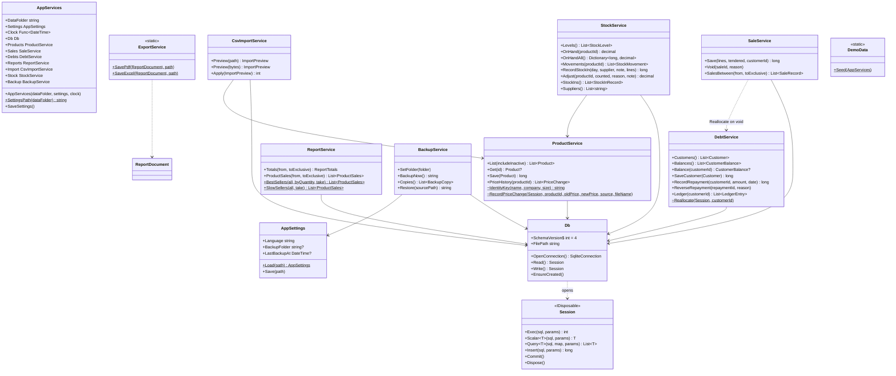
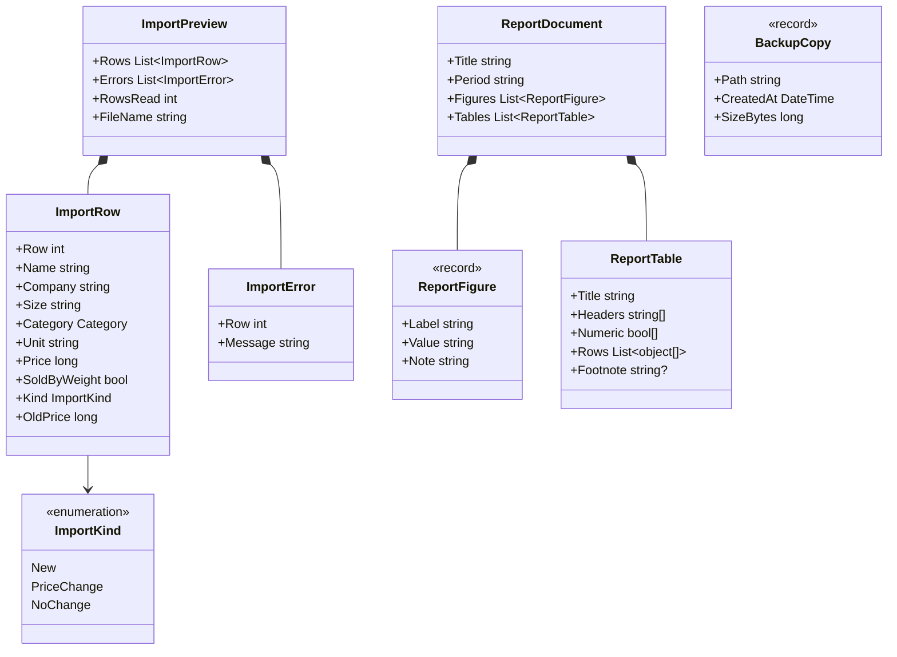
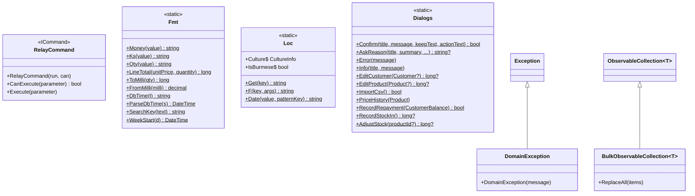
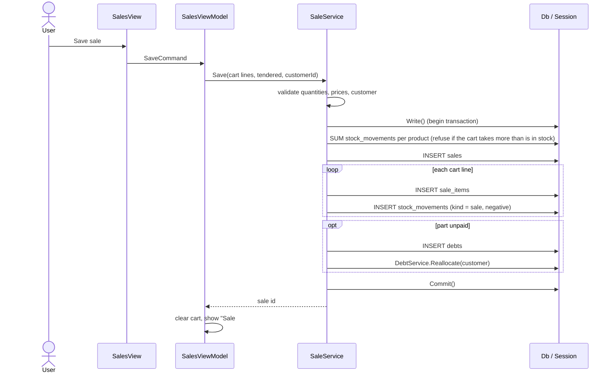

# Store POS: Low-Level Design (UML class diagrams)

Store POS is a WPF app in the MVVM pattern. The code has four layers, and each layer only calls the one below it:

| Layer | Folder | Job |
|---|---|---|
| Views | `Views/`, `Dialogs/`, `Controls/`, `MainWindow.xaml` | XAML screens and dialogs, bound to view models |
| View models | `ViewModels/` | Screen state, filtering and commands |
| Services | `Services/` | Business rules; every multi-row write is one transaction |
| Data | `Data/Db.cs` | SQLite connection, schema and upgrades |

`Models/` holds the plain data classes that pass between the layers, and `Infrastructure/` holds shared helpers (formatting, translations, MVVM base classes).

The diagrams below are split by layer so each stays readable. Private fields and helper methods are left out.

## 1. Overview

## 2. Data layer and services

### Import and export types

## 3. Domain models (`Models/Models.cs`)

```mermaid
classDiagram
    class Product {
        +Id long
        +Name string
        +Company string
        +Size string
        +Category Category
        +Unit string
        +Price long
        +SoldByWeight bool
        +Active bool
        +PriceChangedAt DateTime?
        +FullName string
        +FormatFullName(name, size, company)$ string
    }
    class Category {
        <<enumeration>>
        Pesticide
        Herbicide
        Fertilizer
        Seed
        Other
    }
    class Customer {
        +Id long
        +Name string
        +Address string
        +Phone string?
        +Display string
    }
    class CustomerBalance {
        +Customer Customer
        +Balance long
    }
    class SaleLineInput {
        <<record>>
        +ProductId long
        +Name string
        +Unit string
        +SoldByWeight bool
        +Quantity decimal
        +UnitPrice long
        +ListPrice long
        +LineTotal long
    }
    class SaleRecord {
        +Id long
        +SoldAt DateTime
        +Total long
        +AmountPaid long
        +CustomerId long?
        +CustomerName string?
        +Voided bool
        +VoidReason string?
        +Items List~SaleItemRow~
        +Owed long
    }
    class SaleItemRow {
        +ProductId long
        +Name string
        +Unit string
        +SoldByWeight bool
        +Quantity decimal
        +UnitPrice long
        +LineTotal long
        +Describe() string
    }
    class LedgerKind {
        <<enumeration>>
        CreditSale
        Repayment
    }
    class LedgerEntry {
        +Kind LedgerKind
        +Id long
        +Date DateTime
        +SaleTotal long
        +SalePaid long
        +Amount long
        +Cancelled bool
        +Reason string?
        +ItemsText string
        +BalanceAfter long
    }
    class PriceSource {
        <<enumeration>>
        Added
        Edited
        CsvImport
    }
    class PriceChange {
        +Id long
        +At DateTime
        +OldPrice long?
        +NewPrice long
        +Source PriceSource
        +FileName string
    }
    class StockMoveKind {
        <<enumeration>>
        Sale
        Void
        StockIn
        Adjustment
    }
    class AdjustReason {
        <<enumeration>>
        Damaged
        CountWrong
        Expired
        Other
    }
    class StockLevel {
        +Product Product
        +OnHand decimal
        +LastStockIn DateTime?
        +IsOut bool
    }
    class StockMovement {
        +Id long
        +At DateTime
        +Kind StockMoveKind
        +Change decimal
        +After decimal
        +SaleId long?
        +CustomerName string?
        +Supplier string
        +Reason AdjustReason?
        +Note string
    }
    class StockInLineInput {
        <<record>>
        +ProductId long
        +Quantity decimal
    }
    class StockInRecord {
        +Id long
        +ReceivedAt DateTime
        +Supplier string
        +Note string
        +Lines List~StockInLine~
    }
    class StockInLine {
        +ProductId long
        +Name string
        +Quantity decimal
        +After decimal
        +Before decimal
    }
    class ProductSales {
        +ProductId long
        +Name string
        +Unit string
        +SoldByWeight bool
        +Quantity decimal
        +Amount long
    }
    class ReportTotals {
        +TotalSold long
        +CashAtSale long
        +Repayments long
        +CashReceived long
        +CreditGiven long
        +CreditSales int
        +SalesCount int
        +VoidedCount int
    }

    Product --> Category
    CustomerBalance --> Customer
    SaleRecord *-- SaleItemRow
    LedgerEntry --> LedgerKind
    PriceChange --> PriceSource
    StockLevel --> Product
    StockMovement --> StockMoveKind
    StockMovement --> AdjustReason
    StockInRecord *-- StockInLine
```

Static helpers in the same file: `Categories`, `Units` (bottle / bag codes and their display names) and `AdjustReasons` (database codes and display names).

## 4. View models

```mermaid
classDiagram
    class ObservableObject {
        <<abstract>>
        +PropertyChanged event
        #Set~T~(ref field, value, name) bool
        #OnPropertyChanged(name)
    }
    class IPage {
        <<interface>>
        +Activate()
    }
    class Section {
        <<enumeration>>
        Sales
        Prices
        Stock
        Debts
        Reports
        Backup
    }
    class MainViewModel {
        +SalesPage SalesViewModel
        +PricesPage PricesViewModel
        +StockPage StockViewModel
        +StockInsPage StockInsViewModel
        +DebtsPage DebtsViewModel
        +ReportsPage ReportsViewModel
        +BackupPage BackupViewModel
        +NavigateCommand RelayCommand
        +Navigate(Section)
        +OpenCustomer(customerId)
        +OpenStockIns()
        +DataReplaced()
        +UpdateBackupNote()
        +StartBackgroundBackup()
    }
    class SalesViewModel {
        +ProductsView ListCollectionView
        +Cart ObservableCollection~CartLine~
        +Customers ObservableCollection~CustomerOption~
        +AddToCartCommand RelayCommand
        +RemoveLineCommand RelayCommand
        +ClearCartCommand RelayCommand
        +SaveCommand RelayCommand
        +NewCustomerCommand RelayCommand
        +AddOne(ProductRow)
        +ClearAfterRestore()
    }
    class CartLine {
        +Product Product
        +ListPrice long
        +AddQuantity(more)
        +ToInput() SaleLineInput
    }
    class PricesViewModel {
        +View ListCollectionView
        +AddCommand RelayCommand
        +EditCommand RelayCommand
        +HistoryCommand RelayCommand
        +ImportCommand RelayCommand
        +Edit()
    }
    class StockViewModel {
        +View ListCollectionView
        +CategoryOptions List~FilterOption~
        +Movements List~MovementRow~
        +ShowHistoryCommand RelayCommand
        +AdjustCommand RelayCommand
        +RecordInCommand RelayCommand
    }
    class StockInsViewModel {
        +View ListCollectionView
        +ShowCurrentCommand RelayCommand
        +RecordInCommand RelayCommand
    }
    class DebtsViewModel {
        +View ListCollectionView
        +OpenCommand RelayCommand
    }
    class CustomerDetailViewModel {
        +Rows BulkObservableCollection~LedgerRow~
        +BackCommand RelayCommand
        +EditCommand RelayCommand
        +RecordRepaymentCommand RelayCommand
        +ReverseCommand RelayCommand
    }
    class ReportsViewModel {
        +Best BulkObservableCollection~BestRow~
        +Slow BulkObservableCollection~BestRow~
        +DaySales BulkObservableCollection~DaySaleRow~
        +WeekBars BulkObservableCollection~DayBar~
        +PrevCommand RelayCommand
        +NextCommand RelayCommand
        +ExportExcelCommand RelayCommand
        +ExportPdfCommand RelayCommand
        +SortBest(byQty)
        +Refresh()
        +BuildDocument() ReportDocument
    }
    class BackupViewModel {
        +Copies BulkObservableCollection~BackupCopyRow~
        +ChooseFolderCommand RelayCommand
        +BackupNowCommand RelayCommand
        +RestoreCommand RelayCommand
        +RestoreFromFileCommand RelayCommand
        +AutoBackupFinished(error)
    }

    ObservableObject <|-- MainViewModel
    ObservableObject <|-- SalesViewModel
    ObservableObject <|-- CartLine
    ObservableObject <|-- PricesViewModel
    ObservableObject <|-- StockViewModel
    ObservableObject <|-- StockInsViewModel
    ObservableObject <|-- DebtsViewModel
    ObservableObject <|-- CustomerDetailViewModel
    ObservableObject <|-- ReportsViewModel
    ObservableObject <|-- BackupViewModel

    IPage <|.. SalesViewModel
    IPage <|.. PricesViewModel
    IPage <|.. StockViewModel
    IPage <|.. StockInsViewModel
    IPage <|.. DebtsViewModel
    IPage <|.. CustomerDetailViewModel
    IPage <|.. ReportsViewModel
    IPage <|.. BackupViewModel

    MainViewModel --> Section
    MainViewModel *-- SalesViewModel
    MainViewModel *-- PricesViewModel
    MainViewModel *-- StockViewModel
    MainViewModel *-- StockInsViewModel
    MainViewModel *-- DebtsViewModel
    MainViewModel *-- ReportsViewModel
    MainViewModel *-- BackupViewModel
    MainViewModel ..> CustomerDetailViewModel : OpenCustomer()
    SalesViewModel *-- CartLine
```

Row classes used by the grids (`ProductRow`, `StockRow`, `MovementRow`, `StockInRow`, `DebtRow`, `LedgerRow`, `DaySaleRow`, `BestRow`, `DayBar`, `BackupCopyRow`, `CustomerOption`, `SizeOption`, `FilterOption`) wrap a model and add display text and search keys. They are left out of the diagram.

## 5. Infrastructure and dialogs

- **`DomainException`** is thrown by services when a rule is broken (for example "a credit sale needs a customer"). View models catch it and show the message with `Dialogs.Error`.
- **`Loc`** reads `Resources/Strings.resx` (English) and `Strings.my.resx` (Burmese). XAML uses it through the `{l:Tr Key}` markup extension (`TrExtension`).
- **`Fmt`** keeps all number and date formats in one place, with Latin digits in both languages.

## Main flow: saving a sale

